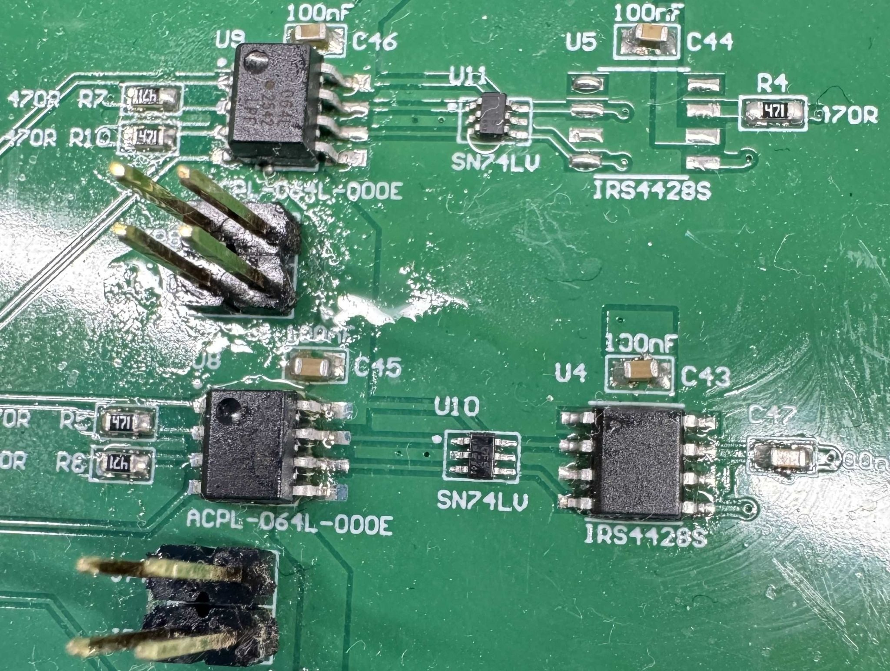

# ±30V H-Bridge Drive

Imagine a H-Bridge with +30V, -30V VCC, VSS (60V Swing). If the goal is to control this H bridge, how would you drive it with 3.3V logic?&#x20;

* If I directly connect the gate to the Q1, the high side PMOS will burn due to Vds being higher than 20V&#x20;
* Regardless of 3.3V high or low, the high side pmos will be always on&#x20;
* Low side NMOS will be always turned on, as it is experiencing vgs of 30V + 3.3V = 33.3V.  Before turning on, it would burn due first due to extreme voltage difference.&#x20;

Unfortunately at the beginning of my work, I did not knew about the logic isolator or the isolated gate driver that would get rid of different potential/different voltage.&#x20;

One way that I thought of solving this problem was using Opto-Isolator + Inverter.&#x20;

Because Opto-isolator output inverted logic, I could just add an simple SN74 inverter to flip the logic voltage.

For 3.3V logic from stm32/MSP430, the 0V to 3.3V PWM is level-shift to -30V, -26.7V PWM. Now, the gnd is -30V.&#x20;

However, because the opto-isolator outputs the inverted logic, the signal has to be flipped by SN74 logic inverter.  

The signal is then fed to gate driver. Simply, If A is high, out A is low. If B is high, out B is high. The high side is flipped for driving a high side NMOS.&#x20;

However, because the application requires long mosfet turn on time (more than 10ms), the charge pump approach for high side nmos does not work. Either dedicated charge pump that generate vgs turn on voltage need to exist. However, for PMOS it is easier to pull down low. For turning on high side pmos, I just need to pull down high side pmos gate to +30V to 18V. An simple capacitor level shifter would work this way, but the voltage level shifting would not work for prolonged time.&#x20;

If you use above level shifter for turning on the high side PMOS for more than 100us, the PMOS will burn&#x20;

The high side PMOS will eventually burn because once the capacitor is charged and voltage flips back from 0V to 12V, the 60V + 12V charge will be pushed to the PMOS gate which will be way above the Vgd threshold of 20V.&#x20;

 

To prevent that, an low side bjt will be used. Because this BJT is sinking mA range current, the package can be SOT-23 with $0.1 cost.

 

\
Surprisingly, combination of Opto-Isolator + SN74 Inverter worked well. In the oscilloscope the rising edge and falling edge was crisp clear up to 20khz of switching frequency. I was worried about blurry PWMs due to multiple stages and missing decoupling capacitor for inverter but it worked well.

### Update #1 - Logic Isolator&#x20;

I realized that there is logic isolator after finishing soldering first PCB while learning about isolated RS-485 driver.&#x20;

\
Now the design is much more simplified with higher slew rate of digital isolator with up to 50mbps.&#x20;

### Update #2 - Isolated Gate Driver&#x20;

It is better to put all-in-one chip for minimal pcb side and easy soldering. Below was the easiest setup for digital pwm input while having a full isolation with driving H bridge.

\
\
\
 
