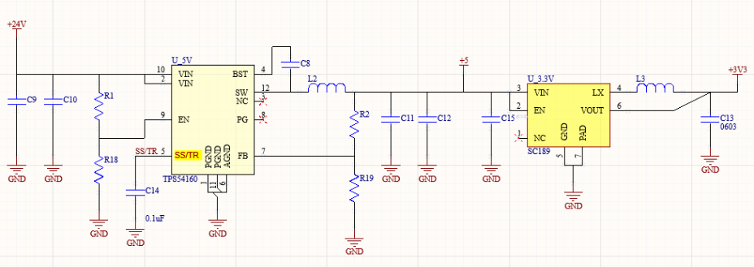

# Cascading Buck Converter Error

Probably everyone's project have at least two Buck/Linear Voltage Regulator&#x20;

1. Input Voltage ➔ 5V
2. 5V ➔ 3.3V Logic Voltage for Microcontroller&#x20;

This post is about the common error that people can face day to day project:&#x20;

## Cascading Buck converter error schematic&#x20;

Can you catch any error in above typical schematic?&#x20;

Sometimes EN pins are directy tied to VIN.&#x20;

However, if the previous buck converter have a slow start, it could cause an issue for downside buck converter&#x20;

## 5V Slow Start + Massive 3.3V 100nF Parallel Capacitor&#x20;

Board with above layout had 30% failure rate due to failing 3.3V.&#x20;

The problem that the 3.3V Buck converter faced was:&#x20;

1. 5V rail reached its nominal voltage slowy due to slow start (SS/TR pin in TPS54160)
2. Massive, multiple 100nF, 1uF, 330nF decoupling capacitors for FPGA, RS-485 Driver, Opto-Isolator, 144QFN package NXP controller  ➔ Massive Inrush Current at beginning for 3.3V Buck Converter&#x20;

## SS/TR piin of TPS54160&#x20;

looking at the TI Datasheet, capacitor connected to SS/TR pin determines the slow start time.  

$$100\,\text{nF} = \frac{T_{\text{ss}} \cdot 2\,\mu\text{A}}{0.8\,\text{V} \cdot 0.8} \\[10pt] T_{\text{ss}} = 32\,\text{ms} \quad \text{(to reach 90\% of slow start)}$$

So, 5V will take **32ms** to be fully ready. &#x20;

However, SC189ZULTRT will turn on when EN pin voltage is higher than the threshold.&#x20;

* For the first few cycles, the buck converter will try to output 3.3V from 2V  (Duty Cycle = 1)
* Overcurrent is triggered and buck converter goes to HICCUP mode&#x20;
* After several µs attempts, the controller reattempts to regulate current. However, the slow start time is in ms range while the HICCUP cycles are in µs range. After multiple attempt, the buck converter gives up. Even after the 5V is fully saturated, the buck converter duty cycle is fixed. When load is added, the voltage will simply drop.
* Most controllers output 2.1V or 2.5V, or 1.8V

<figure><figcaption></figcaption></figure>

## Temporary Solution - Current Choker&#x20;

Because each boards are $6000 with FPGA + Controller + other devices (Fabs charge really high)

I had to find the way to somehow make this 3.3V work without changing the footprint. \
\
One way I thought of is putting a Ferrite bead to choke the current at the beginning. \
\
Although initial issue is that the voltage divider or PG signal is missing for 3V3, this was worth attempting.&#x20;

This method worked, by choking all the inrush currents going to massive 100nF bank for Xilinx FPGA.&#x20;

Fortunately, all of logic ICS operating voltage was from 3V to 3.6Vish range. However, the issue was that the 3.3V dropped to 3.15V which affects the DAC outputs, affecting OPAMP gains and other setups.&#x20;

## Permanent Fix&#x20;

The only way to fix this issue is by adding resistor divider so that the buck converter does not start early before 5V rail is ready.&#x20;

I simply chose resistors that were already in BOM.&#x20;

