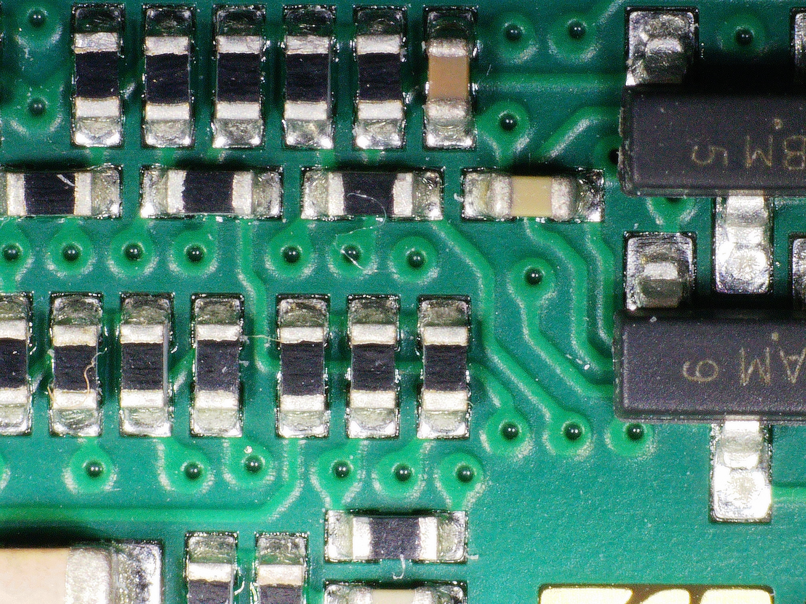
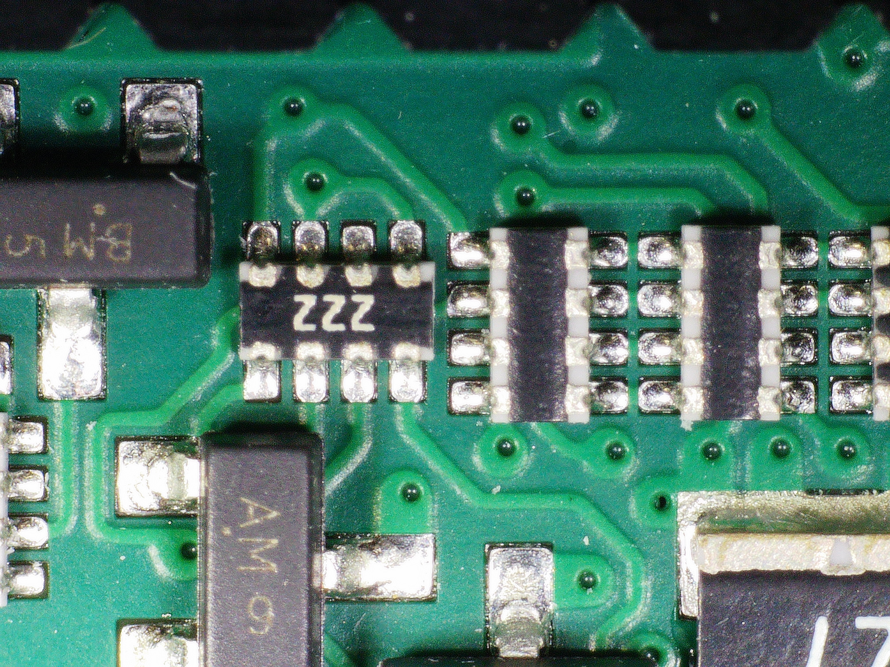
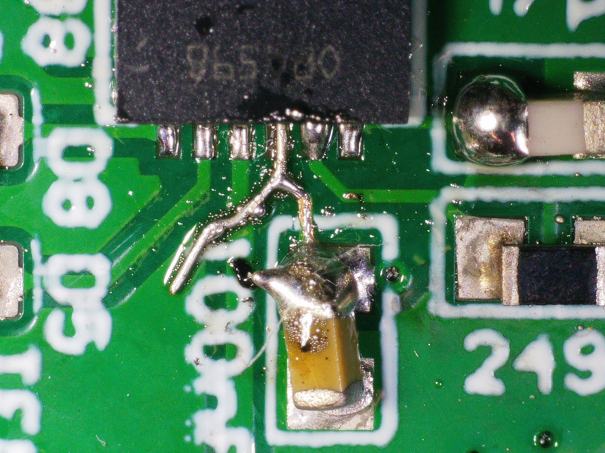
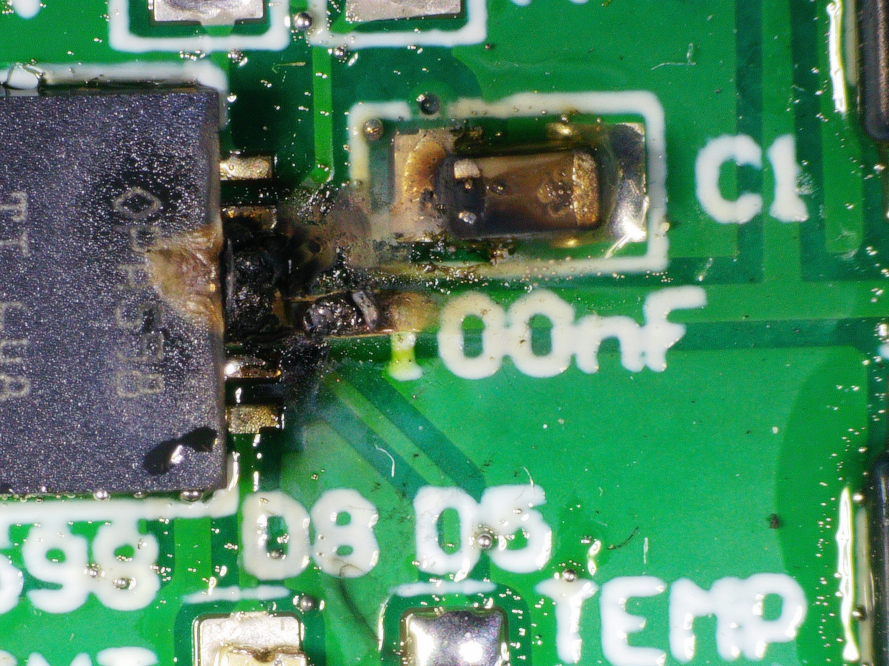
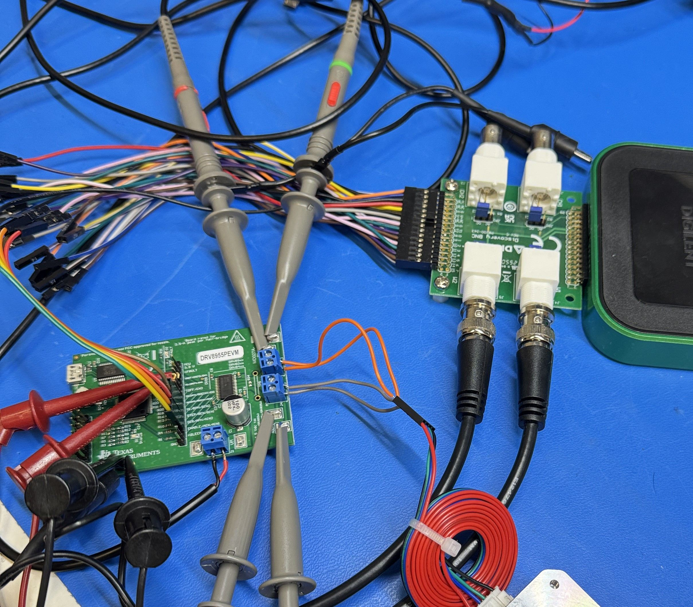

# Design Photo Collections

### 0402, Clearance 0.152mm&#x20;

<figure><figcaption></figcaption></figure>

<figure><figcaption></figcaption></figure>

### Bursted 0.254mm 60V Trace&#x20;

<figure><figcaption></figcaption></figure>

<figure><figcaption></figcaption></figure>

### Quadruple Half Bridge Control&#x20;

<figure><figcaption></figcaption></figure>

### Triple 3W, 2512 Resistor&#x20;

<figure><figcaption></figcaption></figure>

### 1GBE PHY Routing&#x20;

<figure><figcaption></figcaption></figure>

### Negative Voltage Generator&#x20;

<figure><figcaption></figcaption></figure>

### Isolated 75V Gate Driver: N15V \~ 60V&#x20;

<figure><figcaption></figcaption></figure>

### Ideal Current Source&#x20;

<figure><figcaption></figcaption></figure>

### Type II Compensator&#x20;

<figure><figcaption></figcaption></figure>

### $400 Power OPAMP&#x20;

<figure><figcaption></figcaption></figure>

### TO-263 EVOO Transistor&#x20;

<figure><figcaption></figcaption></figure>

