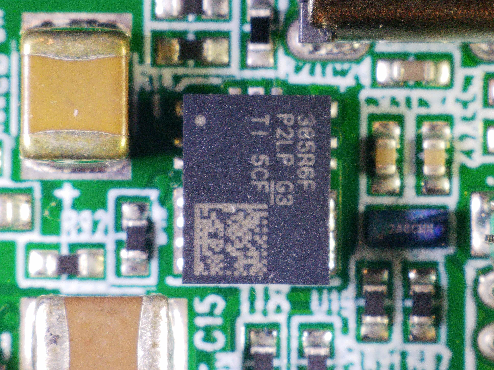
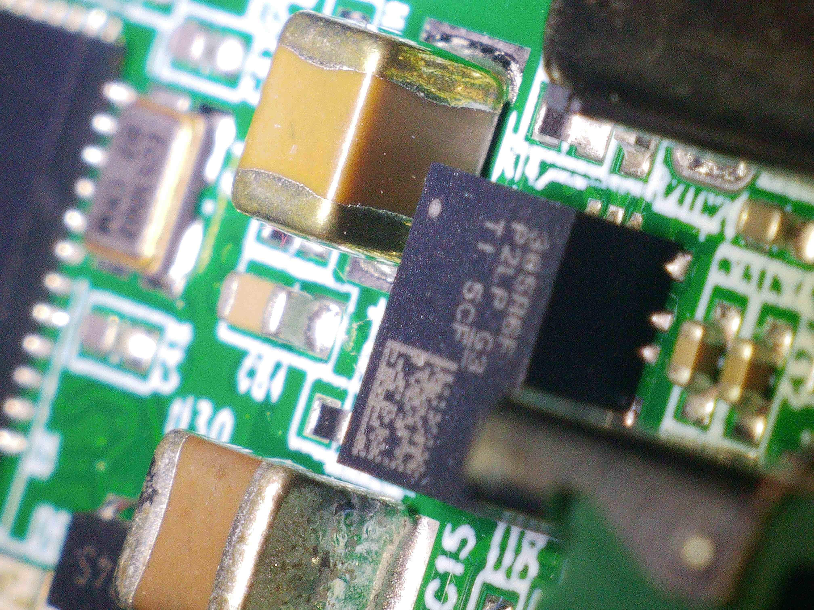

# TPSM365R6

<figure><figcaption></figcaption></figure>

<figure><figcaption></figcaption></figure>

## Integrated Inductor Buck Converter

For an ultra compact, multi-layer with less than 100mm X 100mm PCB, it is hard to shove in an buck converter, as both top and bottom layers are already full with mutple BGA via routing.&#x20;

However, there is still an need to 5V and 3.3V logic voltage. We need space as tiny as LDO yet the brutal thermal of PCB does not have an additional thermal capacity to withstand the LDO heating. &#x20;

It is where Texas Instrument's Integrated Inductor Buck Module comes in - Because inductor is embedded, the minimal space required for inductor clearance is gone, and the layout space becomes as compact as 6-DFN packages.&#x20;

the module can work with only Input capacitor and output capacitor, just like an LDO.&#x20;

## Thermal Cam

<figure><figcaption></figcaption></figure>

* Considering that this Buck is outputting 54V to 5V 600mA, it is an impressive result, considering how much compact space it is saving (LMR36506 with low profile, compact inductor with high DCR would heat up more than this)
* Lacking thermal vias underneath (there was some signal going below that prevented thermal via placement)

For next layout I would need to lower switching frequency around 800khz from 1mhz to lower switching loss. &#x20;
